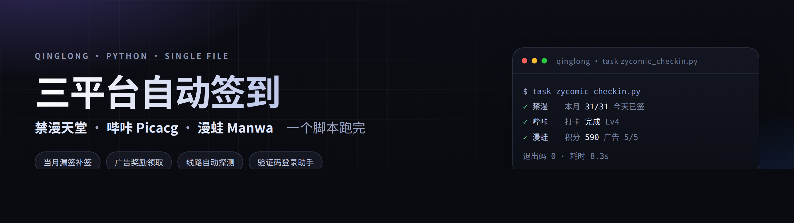

<div align="center">
  

  <p>
    
    
    
    
    
  </p>

  <p>
    <a href="#快速开始">快速开始</a> ·
    <a href="#环境变量">环境变量</a> ·
    <a href="#漫蛙登录助手">登录助手</a> ·
    <a href="#常见问题">常见问题</a> ·
    <a href="https://github.com/fuoins/zycomic-checkin/releases">更新日志</a>
  </p>
</div>

一个 Python 文件，跑完 **禁漫天堂 / 哔咔 Picacg / 漫蛙 Manwa** 的每日签到。协议按各平台 App 的真实请求提取，不依赖浏览器，也不需要抓包工具常驻。

## 支持平台

| 平台 | 能做什么 | 需要的凭据 |
| :--- | :--- | :--- |
| **禁漫 JM** | 每日签到 · 当月漏签自动补签 · 签完复查 | `JM_USER` / `JM_PASS` |
| **哔咔 Picacg** | 每日打卡 · 打卡后复查 `isPunched` | `PICACG_USER` / `PICACG_PASS` |
| **漫蛙 Manwa** | 每日签到 · 看 5 次广告领积分 | `MANWA_COOKIE`（推荐）或账号密码 + 验证码 |

## 亮点

- **补签不靠猜** — 禁漫从当月日历里读 `record[].date`，只补状态为漏签的日期，签完再拉一次日历复核。
- **线路自动探测** — 内置线路优先，成功的线路写进 `picacg_host.txt` / `manwa_host.txt`，下次 1~3 秒就能定线路；远程配置只在内置全挂时兜底。
- **IP 直连网络层** — 哔咔固定走「DNS 解析 IP + SNI 保持域名」直连：候选顺序为上次成功的最优 IP（缓存）→ SmartDNS 干净 IP 池 → 内置 Cloudflare anycast，慢 IP 超时自动轮换，不再做竞速判定，也不会被 DNS 污染拖到逐个请求干等几十秒。
- **状态不误报** — 漫蛙 `signedtoday` / `signednot` / 空占位全部识别，再用积分明细交叉验证，不会把「未签」写成「已签」，也不会把「N 天未签到」的扣分记录当成签到成功。
- **验证码有解** — `login` 会在本地起一个小页面，给出验证码图片直链，手机上看图输码即可，不用装抓包 App。

## 快速开始

```bash
# 1. 装依赖
pip3 install requests pycryptodome

# 2. 配环境变量（青龙「环境变量」页添加，或本地 export）
export JM_USER=你的账号      JM_PASS=你的密码
export PICACG_USER=你的用户名 PICACG_PASS=你的密码
export MANWA_COOKIE='PHPSESSID=...; uid=...'

# 3. 跑
python3 zycomic_checkin.py          # 三个平台依次跑，没配的自动跳过
python3 zycomic_checkin.py manwa    # 只跑漫蛙（可换 jm / picacg）
```

**青龙三步**

1. 脚本管理 → 新建 `zycomic_checkin.py` → 粘贴 [脚本](https://raw.githubusercontent.com/fuoins/zycomic-checkin/main/zycomic_checkin.py)
2. 定时任务 → 新建 → 命令 `task zycomic_checkin.py` → cron `10 0 * * *`
3. 依赖管理 → Python3 → 添加 `requests`、`pycryptodome`

> 三个平台在同一个任务里串行跑，请求之间内置 2 秒间隔，比拆成三个任务同时打要安全。

## 漫蛙登录助手

漫蛙登录强制图形验证码，而且**验证码绑定会话** —— 直接拿接口地址去浏览器打开，看到的是另一个会话的图，输进去必然失败。所以脚本自己起一个本地页面，把这张图挂出来：

<div align="center">
  
</div>

```bash
python3 zycomic_checkin.py login                      # 本机：自动开浏览器
python3 zycomic_checkin.py login --bind 0.0.0.0       # 手机同局域网访问
python3 zycomic_checkin.py login --no-web             # 无终端：存图 + 两步式输入
```

| 场景 | 说明 |
| :--- | :--- |
| 本机运行 | 直链是 `127.0.0.1`，登录成功自动写入 `manwa_cookie.txt` |
| 手机看 | 加 `--bind 0.0.0.0`，直链换成局域网 IP，同一个 WiFi 即可 |
| 青龙容器 | 需要映射端口；开不了端口就用 `--no-web`，看图后设 `MANWA_CAPTCHA=四位码` 再跑一次 |

页面带一次性口令（`?k=xxxxxxxx`），10 分钟无操作自动退出，同网段别人拿到地址也进不去。

## 环境变量

### 禁漫

| 变量 | 必填 | 说明 |
| :--- | :---: | :--- |
| `JM_USER` / `JM_PASS` | 是 | 账号密码 |
| `JM_API_HOST` | 否 | 自定义线路，逗号分隔 |
| `JM_TRY_MAKEUP` | 否 | `0` 关闭当月漏签自动补签（默认开） |

### 哔咔

| 变量 | 必填 | 说明 |
| :--- | :---: | :--- |
| `PICACG_USER` / `PICACG_PASS` | 是 | 用户名 + 密码（接口字段叫 email，填用户名即可） |
| `PICACG_API_HOST` | 否 | 自定义线路，逗号分隔 |
| `PICACG_APP_UUID` | 否 | 固定设备 UUID，不填每次随机 |
| `PICACG_ROUTE` | 否 | 默认 `ip` 固定 IP 直连；`domain` 手动退回域名直连（走系统 DNS，适合代理环境） |
| `PICACG_ROUTE_TTL` | 否 | 最优 IP 缓存秒数（默认 86400 = 1 天） |
| `PICACG_DNS_TTL` | 否 | SmartDNS IP 池缓存秒数（默认 604800 = 7 天） |

### 漫蛙

| 变量 | 必填 | 说明 |
| :--- | :---: | :--- |
| `MANWA_COOKIE` | 推荐 | `PHPSESSID=...; uid=...`，`login` 会自动生成 |
| `MANWA_USER` / `MANWA_PASS` | 否 | 账号密码，配合验证码助手使用 |
| `MANWA_CAPTCHA` | 否 | 两步式登录：看图后把验证码填这里 |
| `MANWA_AD_BONUS` | 否 | `0` 关闭看广告领积分（默认开） |
| `MANWA_API_HOST` | 否 | 自定义线路，逗号分隔 |
| `MANWA_DEVICE_ID` | 否 | 设备 ID，默认沿用 App 内置值 |
| `MANWA_CAPTCHA_OCR` | 否 | `1` 用 ddddocr 自动识别验证码 |
| `MANWA_SNI_OMIT` | 否 | `1` 对自定义线路用空 SNI 直连（TLS 跳过证书校验，仅在被 SNI 干扰时开） |

## 输出

```text
[总览] ===== 禁漫 开始 =====
[禁漫] 登录成功 uid=100000 线路=https://www.cdnutc.me
[禁漫] 账户：demo_user Lv7 coin=13042 exp=13625
[禁漫] 活动：10月-「來都來了」（daily_id=73）本月 31/31
[禁漫] 今天（2026-10-31）已签到，无需重复
[禁漫] 复查：今天已签，本月 31/31
[总览] ===== 禁漫 成功（3.1s）：本月 31/31，今天已签 =====
...
[总览] 汇总 ↓
    禁漫: [成功] 本月 31/31，今天已签
    哔咔: [成功] demo_user 打卡=完成
    漫蛙: [成功] 积分 590，今日已签，广告 5/5
```

末尾会调青龙自带的 `notify.send()` 推一条汇总，没配通知渠道时静默跳过。任一平台失败 → 退出码 `1`，方便青龙标红。

<details>
<summary><b>接口实现要点（接口变动时排查用）</b></summary>

- **禁漫**：`token=md5(ts+"18comicAPPContent")`、`tokenparam=ts,2.0.16`；响应 `data` 为 AES-256-ECB，key = `md5(ts+"185Hcomic3PAPP7R")` 的 32 位 hex 按 UTF-8 取字节；日历 `record[].date` 只有两位「日」，补签要自己拼成 `YYYY-MM-DD`。
- **哔咔**：`signature = HMAC-SHA256(key, (path+time+nonce+method+apiKey).lower())`；业务错误也是 HTTP 200 + `code=200`，真实错误在 `errorMsg`、`data` 为空数组，必须额外校验 data 形状。API 基地址是 `https://picaapi.go2778.com`，而 `www.cdnhjk.net` / `www.cdngwc.cc` 这些是网页站，对任何账号都返回 `Not legal.auth`。
- **漫蛙**：每请求带 `facility/deviceid/timestamp`，`X-Token=md5(ts+盐)`；响应非 JSON 时按 AES-256-ECB 解密，key = `md5(ts+另一个盐)`。签到是 `POST /api/users/welfare {"date":"当月1号"}`，广告奖励是 `{"action":"ad_bonus"}`。
- **漫蛙状态枚举**：`sign_list[].status` 实测为 `signedin`（已签）、`signedtoday`（今天刚签）、`signednot`（漏签）、空串（占位）。福利接口不返回 `user_data`，积分要回落 `/api/users/info`。
- **漫蛙积分明细**：`GET /api/users/point_logs?page=1`，`data.list[].title` 形如「每日签到(已连续签到1天)」「每日广告点击奖励」「“2”天未签到」。

</details>

## 常见问题

<details>
<summary><b>哔咔报 <code>Not legal.auth</code></b></summary>

请求打到了网页站。当前版本已固定走 `picaapi.go2778.com`；如果你手动设了 `PICACG_API_HOST`，删掉或改成这个地址。
</details>

<details>
<summary><b>哔咔报 <code>error=1004 invalid email or password</code></b></summary>

真·账号密码错误。接口字段虽然叫 `email`，填的是**用户名**（不带 @ 的那个）。
</details>

<details>
<summary><b>漫蛙显示「今日=未知」</b></summary>

服务端 `sign_list` 里没有能对上今天的项。脚本会先查积分明细兜底（今天有「每日签到」入账即判已签），仍判断不出来才显示未知，并打印 `sign_list` 样例。不影响签到本身。
</details>

<details>
<summary><b>开头要等半分钟</b></summary>

旧版每次先拉远程线路配置（最长 15 秒），再串行试线路（每条 10 秒）。现在内置线路优先、探测并发，成功线路落盘缓存，通常 1~3 秒定线路。
</details>

<details>
<summary><b>哔咔每次请求都超时重试，整轮跑 5 分钟</b></summary>

这是本地 DNS 解析到劣质/污染 IP 的典型表现。v1.2.0 起哔咔**固定 IP 直连**：请求不再走本地 DNS，TCP 直接连候选 IP（TLS 的 SNI 与证书校验仍按域名，服务端视角不变）。候选顺序：上次成功的最优 IP（缓存 1 天）→ SmartDNS 干净 IP 池 → 内置 anycast 兜底；单个 IP 超时（5 秒）自动轮换下一个，成功后沿用并回写缓存，下次启动直接复用。

- 有代理 / 需要走域名解析：设 `PICACG_ROUTE=domain`（配合任务里的 `HTTPS_PROXY` 使用）。
- SmartDNS 缓存文件 `picacg_dns.txt`、最优 IP 缓存 `picacg_route.txt` 均自动生成，删掉即可强制刷新。
- 全部候选 IP 都不通（SNI 级干扰）：会明确报错，挂代理是唯一解。
</details>

<details>
<summary><b>漫蛙线路报 <code>string argument should contain only ASCII characters</code></b></summary>

该线路被劫持或需要代理，返回了带中文的响应头。脚本会跳过它；并发探测下这类坏线路不会拖慢启动。
</details>

## 免责声明

- 仅用于**个人账号的日常自动化**与协议学习，请勿用于批量注册、刷量或其他违反平台条款的用途。
- 调用的是各平台 App 的接口，随时可能变更；不保证长期可用，也不对账号被风控、封禁负责。
- 本项目不提供、不托管任何漫画内容，也不绕过付费/付费墙机制，只做「签到领积分」这一件事。
- 看广告任务会真实产生广告点击上报，只建议给自己的账号开启；`MANWA_AD_BONUS=0` 可完全关闭。
- 如有侵权或违反相关条款，请联系删除。

---

<div align="center">
  <sub>如果这个项目帮到了你，点个 Star ⭐ 就是最好的支持</sub>
</div>
