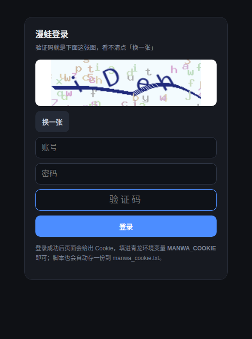

# 三平台自动签到 · 青龙脚本（禁漫 / 哔咔 / 漫蛙）

一个文件跑完 **禁漫 JM / 哔咔 Picacg / 漫蛙 Manwa** 的每日签到，协议按 App 实际请求提取，单文件、无外部框架依赖。

| 平台 | 功能 | 需要的凭据 |
|---|---|---|
| 禁漫 JM | 每日签到 + 当月漏签自动补签 | `JM_USER` / `JM_PASS` |
| 哔咔 Picacg | 每日打卡 + 状态复查 | `PICACG_USER` / `PICACG_PASS` |
| 漫蛙 Manwa | 每日签到 + 看 5 次广告领积分 | `MANWA_COOKIE`（推荐）或账号密码 + 验证码 |

> 只在自己的账号上自用。脚本不做批量注册、不绕过付费内容，签到/广告奖励的积分归账号本人。

```bash
python3 zycomic_checkin.py            # 三个平台依次跑，没配的自动跳过
python3 zycomic_checkin.py jm         # 只跑禁漫（可换 picacg / manwa）
python3 zycomic_checkin.py login      # 漫蛙登录助手：给验证码图片直链，看图输码拿 Cookie
```

## 一、依赖

```bash
pip3 install requests pycryptodome
```

青龙里在「依赖管理 → Python3」加 `requests`、`pycryptodome` 即可。只有想用 OCR 自动识别验证码（`MANWA_CAPTCHA_OCR=1`）时才额外装 `ddddocr`。

## 二、环境变量

### 禁漫

| 变量 | 必填 | 说明 |
|---|---|---|
| `JM_USER` | 是 | 用户名 |
| `JM_PASS` | 是 | 密码 |
| `JM_API_HOST` | 否 | 自定义线路，逗号分隔；默认内置 5 条自动回退 |
| `JM_TRY_MAKEUP` | 否 | `0` 关闭当月漏签自动补签（默认开） |

### 哔咔

| 变量 | 必填 | 说明 |
|---|---|---|
| `PICACG_USER` | 是 | 用户名（接口字段叫 email，填用户名即可） |
| `PICACG_PASS` | 是 | 密码 |
| `PICACG_API_HOST` | 否 | 自定义线路，逗号分隔 |
| `PICACG_APP_UUID` | 否 | 固定设备 UUID，不填则每次随机 |

### 漫蛙

| 变量 | 必填 | 说明 |
|---|---|---|
| `MANWA_COOKIE` | 推荐 | 登录后的 Cookie 串，如 `PHPSESSID=xxx`；`login` 会自动生成 |
| `MANWA_USER` / `MANWA_PASS` | 否 | 账号密码，配合验证码助手使用 |
| `MANWA_CAPTCHA` | 否 | 两步式登录用：看图后把验证码填这里 |
| `MANWA_AD_BONUS` | 否 | `0` 关闭看广告领积分（默认开） |
| `MANWA_API_HOST` | 否 | 自定义线路，逗号分隔 |
| `MANWA_DEVICE_ID` | 否 | 设备 ID，默认沿用 App 内置值 |
| `MANWA_COOKIE_FILE` | 否 | Cookie 缓存文件路径，默认脚本目录 `manwa_cookie.txt` |
| `MANWA_CAPTCHA_OCR` | 否 | `1` 用 ddddocr 自动识别验证码 |

## 三、漫蛙登录（重点）

漫蛙登录接口**强制图形验证码**，而且验证码是**绑定当前会话**的：

- 接口 `GET /api/account/captcha` 直接返回 PNG，但必须带着同一会话的 `PHPSESSID`；
- 换个浏览器打开同一个链接，看到的是另一张图，输进去必然报「验证码错误 請刷新頁面再試」；
- 所以公开的接口直链没用，脚本会自己把这张图挂到一个本地地址上，这才是有意义的直链。

### 方式 A：网页助手（推荐）

```bash
python3 zycomic_checkin.py login
```



脚本会打印两个地址：

```
[登录] 站点线路：https://mseeowpm2.cc
[登录] 验证码图片直链：http://127.0.0.1:8899/captcha.png?k=506dc994cf
[登录] 看图输码页面：http://127.0.0.1:8899/?k=506dc994cf
```

浏览器会自动打开（Windows / macOS / 有桌面的 Linux）。页面里就是验证码大图 + 输入框，填账号密码和验证码点登录即可。
成功后页面会给出 Cookie，点「复制」填进青龙环境变量 `MANWA_COOKIE`；同时脚本会自己存一份到 `manwa_cookie.txt`，**不填环境变量也能用**。

三种网络情形：

| 场景 | 命令 | 说明 |
|---|---|---|
| 本地电脑跑 | `python3 zycomic_checkin.py login` | 直链就是 `127.0.0.1`，开箱即用 |
| 手机看（同一局域网） | `python3 zycomic_checkin.py login --bind 0.0.0.0` | 直链变成 `http://局域网IP:8899/...` |
| 青龙容器里跑 | `--bind 0.0.0.0 --port 8899`，并把容器 8899 端口映射出来 | 用 `http://宿主机IP:8899/...` 打开 |

地址里的 `k=xxxx` 是本次会话的随机口令，防止同网段别人乱点；页面 10 分钟没操作自动退出。

> 青龙容器不方便开端口时，直接用方式 B，或在电脑上跑方式 A 拿 Cookie 再粘进青龙。

### 方式 B：两步式（没有可交互终端时）

```bash
python3 zycomic_checkin.py login --no-web
```

第一次：脚本把验证码存成脚本目录下的 `manwa_captcha.png`，并把会话写进 `manwa_login_state.json`，然后提示你去看图。
看完图后：

```bash
# 青龙：环境变量里加 MANWA_CAPTCHA=图片上的四位码，再运行一次
python3 zycomic_checkin.py login --no-web
```

第二步会用上一步的会话提交验证码，成功后同样输出 Cookie 并落盘。

### 方式 C：自己抓 Cookie

App 登录后用 HttpCanary / Reqable / mitmproxy 抓一次请求，把请求头里的 `Cookie` 整串（`PHPSESSID=...`）填进 `MANWA_COOKIE`。
Cookie 失效时脚本会打日志提示，重新执行方式 A 即可。

> 网页版入口就是线路本身（如 `https://mseeowpm2.cc`），但网页登录拿到的 Cookie 未必和 App 接口通用，优先用上面的助手。

## 四、青龙部署

1. 脚本管理 → 新建脚本 `zycomic_checkin.py`，把文件内容粘进去。
2. 定时任务 → 新建任务，命令 `task zycomic_checkin.py`，cron 建议 `10 0 * * *`（每天 00:10 一次跑完三个平台）。
3. 环境变量按上面的表添加。只想跑某几个平台时，命令改成 `task zycomic_checkin.py jm` 这样即可。

> 一个任务跑三个平台，请求间隔已内置 2 秒，比三个任务同时打要安全。

## 五、输出与通知

```
[15:42:26][总览] ===== 禁漫 开始 =====
[15:42:27][禁漫] 登录成功 uid=100000 线路=https://www.cdnutc.me
[15:42:27][禁漫] 账户：demo_user Lv7 coin=13042 exp=13625
[15:42:28][禁漫] 活动：10月-「來都來了」（daily_id=73）本月 31/31
[15:42:28][禁漫] 今天（2026-10-31）已签到，无需重复
[15:42:29][禁漫] 复查：今天已签，本月 31/31
[15:42:29][总览] ===== 禁漫 成功（3.1s）：本月 31/31，今天已签 =====
...
[15:42:35][总览] 汇总 ↓
    禁漫: [成功] 本月 31/31，今天已签
    哔咔: [成功] xxx 打卡=完成
    漫蛙: [跳过] 未配置 MANWA_COOKIE / MANWA_USER+MANWA_PASS
```

末尾统一调青龙自带的 `notify.send()` 推一条汇总；没配通知渠道时静默跳过，不影响退出码。
任一平台失败 → 退出码 1，方便青龙标红。

## 六、实现要点（接口变动时排查用）

- **禁漫**：`token=md5(ts+"18comicAPPContent")`、`tokenparam=ts,2.0.16`；
  响应 `data` 为 AES-256-ECB，key = `md5(ts+"185Hcomic3PAPP7R")` 的 32 位 hex 按 UTF-8 取字节；
  日历 `record[].date` 只有两位「日」，补签要自己拼成 `YYYY-MM-DD`。
- **哔咔**：`signature = HMAC-SHA256(key, (path+time+nonce+method+apiKey).lower())`；
  业务错误也是 HTTP 200 + `code=200`，真实错误在 `errorMsg`、`data` 为空数组，必须额外校验 data 形状。
  **API 基地址是 `https://picaapi.go2778.com`（备用 `picaapi.picacomic.com`）**，
  而 `www.cdnhjk.net` / `www.cdngwc.cc` 这些是网页站，对任何账号的 `/auth/sign-in`
  都返回 `{"code":200,"data":[],"errorMsg":"Not legal.auth"}`，不能当 API 用。
- **漫蛙**：每请求带 `facility/deviceid/timestamp`，`X-Token=md5(ts+盐)`；
  响应非 JSON 时按 AES-256-ECB 解密，key = `md5(ts+另一个盐)`；
  签到是 `POST /api/users/welfare {"date":"当月1号"}`，广告奖励是 `{"action":"ad_bonus"}`。
  返回的 `sign_list[].status` 实测枚举：`signedin`（已签）、**`signedtoday`（今天刚签）**、
  `signednot`（漏签）、空串（占位）；`date` 格式不固定（见过带 `00:00:00` 的），
  所以状态判断统一抽「月/日」比对，抽不出来时退回 `index`（当月第几天）。
  注意这个接口**不返回 `user_data`**，积分要么在 `data.point`，要么得查 `/api/users/info`。
- **漫蛙积分明细**：`GET /api/users/point_logs?page=1`（需 Cookie），
  `data.list[].title` 形如「每日签到(已连续签到1天)」「每日广告点击奖励」「“2”天未签到」，
  `data.consecutive_sign` 是当前连签天数。

## 七、常见问题

**哔咔报 `登录失败：Not legal.auth`**
说明请求打到了网页站。脚本 2026-10-31 之后的版本已固定走 `picaapi.go2778.com`；
如果你手动设了 `PICACG_API_HOST`，改成 `https://picaapi.go2778.com`。

**哔咔报 `error=1004 invalid email or password`**
这是真·账号密码错误。注意接口字段虽然叫 `email`，实际填的是**用户名**（不带 @ 的那个）。

**漫蛙日志里一堆「广告点击失败：空响应」**
`/ad_click` 成功时返回的就是空 body，旧版把它当失败并重试，5 次点击能拖 2 分钟。
现在按成功处理，几秒结束；日志里会显示真正的进度。

**漫蛙「积分=None」「今日=未签」**
积分字段各线路不一致，脚本会依次找 `user_data.point` → `point` → `points`，最后回落 `/api/users/info`；
今日状态改用最后一次复查的 `sign_list` 判断（兼容 `signedin` / `signed`），
`date` 带时分秒、只有 `10-31`、只有 `31` 都认，匹配不到就显示「未知」，不再误报未签。

**漫蛙显示「今日=未知」（已定位）**
根因是当天签到的状态值叫 `signedtoday`，不是 `signedin`，旧版只认后者，所以永远匹配不上。
现在已经认全（`signedin` / `signedtoday` / `signednot` / 空串）。
另外脚本还会查一次积分明细（`GET /api/users/point_logs`）做交叉验证：今天有「每日签到」入账
就判定为已签，日志会写「签到状态以积分明细为准：今日已签」；
判定时特意排除了「“N”天未签到」这类补扣记录，避免误判成已签。
两者都判断不出来才显示「未知」，并补一行日志把 `sign_list` 的天数和前两条样例打出来：

```
[漫蛙] 签到状态未识别，sign_list 共 31 天，样例：{'date': '2026-10-31T00:00:00+08:00', 'status': 'signedin'}
```

把这一行发出来就能对上格式。不影响签到本身，积分和广告奖励都是正常拿到的。

**开头要等半分钟**
旧版每次启动都先拉一次远程线路配置（最长 15 秒），再把线路一条条串行试（每条 10 秒超时）。
现在内置线路优先、探测并发，并把上次成功的线路写进 `picacg_host.txt` / `manwa_host.txt`，
下次启动 1~3 秒就能定线路；远程配置只在内置线路全挂时才拉。

**漫蛙线路报 `string argument should contain only ASCII characters`**
这条线路被劫持或需要代理，返回了带中文的响应头。脚本会跳过它；由于是并发探测，
这类坏线路不会再拖慢启动。

## 八、注意事项

- 三个平台都做了线路自动探测与失败回退；内置线路优先，`https://zygongyi.de5.net/doh.json`
  里的配置只作兜底。成功线路会缓存在 `picacg_host.txt` / `manwa_host.txt`，删掉就会重新探测。
- 请求之间已内置 1~2 秒间隔，别为了提速删 `time.sleep`，容易触发风控。
- 账号密码只从环境变量读取，不写日志、不落文件；`manwa_cookie.txt` 里只有漫蛙会话 Cookie，注意别外传。
- 看广告会真实产生广告点击上报，只建议给自己账号用。

## 九、免责声明

- 本项目仅用于**个人账号的日常自动化**与协议学习，请勿用于批量注册、刷量或其他违反平台条款的用途。
- 脚本调用的是各平台 App 的公开接口，接口随时可能变更；不保证长期可用，也不对账号被风控、封禁负责。
- 项目不提供、不托管任何漫画内容，也不绕过任何付费/付费墙机制，仅做「签到领积分」这一件事。
- 看广告任务会真实产生广告点击上报，只建议给自己的账号开启；`MANWA_AD_BONUS=0` 可完全关闭。
- 如有侵权或违反相关条款，请联系删除。
